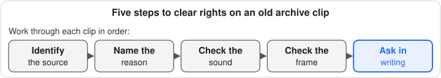

Old archive footage comes from two kinds of places. Free public collections let you download clips at no charge, but you check the rights yourself. Examples are the Library of Congress, the National Archives and the Prelinger collection on Internet Archive. Paid libraries, such as CriticalPast and Historic Films, sell each clip with a written license.

This guide covers five sources and what each one offers as of November 2026. It explains how to check rights before a clip goes into a monetized video. It ends with how to file downloads so the license stays with the clip. Nothing here is legal advice. For a high-stakes project, ask a copyright lawyer.

## What counts as old archive footage?

Old archive footage is any existing moving image you download or license instead of shooting it. Typical examples are newsreels, government films, educational and industrial films, early TV and home movies. For a creator, it's the 1940s newsreel or the launch shot your own cameras could never get.

Age alone doesn't decide whether you can use a clip. Who made it, when it was published, and what the archive says about it matter more. Two copies of the same event can sit in two archives under different terms. One might be a free download, the other a paid license.

## Where can you find old archive footage for free?

Three public sources cover a lot of ground at no charge. Two paid libraries are worth knowing for what the free ones lack. Here is the summary, with prices in US dollars as of November 2026.

| Source | Cost | Rights position, per the source | What you get |
|---|---|---|---|
| Library of Congress, National Screening Room | Free | No known US restrictions on most titles; rights assessment is yours | Most titles as a small MP4 and a ProRes 422 MOV |
| National Archives (NARA) | Free online files; paid transfers for higher-resolution copies | Federal employee works are public domain; NARA doesn't license or confirm status | Digitized files in the online catalog |
| Prelinger Archives on Internet Archive | Free | Creative Commons license shown on each film's page | Many older transfers are standard definition |
| CriticalPast | Free watermarked screeners; masters about $95–$295 per clip | Royalty-free, worldwide, in perpetuity, all media | 1080p HD in ProRes 422 or XDCAM |
| Historic Films | Paid; $500 standard minimum license fee | Licensed for one production; no music or performer rights | Low-resolution previews; masters on order |

### Library of Congress

The Library's [National Screening Room](https://www.loc.gov/collections/national-screening-room/about-this-collection/) holds newsreels, home movies, advertising films and more. The Library says most titles there are free to download as both a small MP4 and a ProRes 422 MOV file. Grab the ProRes file for editing, and check its frame size, because that depends on the title.

The rights statement is careful. The Library says it is [not aware of US copyright or other restrictions](https://www.loc.gov/collections/national-screening-room/about-this-collection/rights-and-access/) on the vast majority of these films. It also says rights assessment is your responsibility. A few copyrighted films, such as the Gershwin home movies, are there by special permission for educational use only. Read each item's catalog record before you use it.

### National Archives (NARA)

The [National Archives in College Park](https://www.archives.gov/research/motion-pictures) holds more than 520,000 film reels and 170,000 video recordings. A growing share is downloadable from its online catalog. High-resolution files of Apollo mission films from 1967 to 1969 are among the recent additions.

NARA does not license footage. For a better copy than the catalog file, you [pay a transfer charge and a per-reel handling fee](https://www.archives.gov/research/motion-pictures/order) to an approved vendor. NARA says to allow at least four to six weeks. NARA also won't confirm whether an item is public domain. Its holdings include donated and copyrighted material, and that check stays with you.

### Prelinger Archives on Internet Archive

Internet Archive is a mix of public domain films and user uploads. The archive itself [makes no guarantees about the copyright status](https://help.archive.org/help/rights/) of items on archive.org. Treat any upload as unverified until you trace it.

The Prelinger collection is the stronger starting point. According to its [help page](https://help.archive.org/help/prelinger-archive/), every title was checked for copyright status before it went online. Each film carries the Creative Commons license shown on its page. Many older Prelinger files came from Betacam SP tape and were encoded at standard definition in 2001–2003. For a written license or a better file, the page points to Getty Images.

### CriticalPast (paid)

[CriticalPast](https://www.criticalpast.com/) calls itself one of the largest royalty-free archival footage collections. Its home page listed 60,008 viewable clips when checked. The clips come from declassified US government films, plus gifted collections such as the Universal Newsreels.

Per its [FAQ](https://www.criticalpast.com/all/faq), registered users can download full-resolution screeners free, with the logo and timecode burned in. Unmarked masters cost about $95 to $295 per clip, depending on length and format. Masters are 1920×1080 HD, with the film image pillarboxed. You choose ProRes 422 or Sony XDCAM HD422. The license is royalty-free, worldwide, in perpetuity, for all media.

### Historic Films (paid)

[Historic Films](https://www.historicfilms.com/library) focuses on music performances, entertainment TV and newsreels. Its collections include the Bob Hope archive, about 450 hours, and over 300 hours of classic comedies. A paid "Pro" account lets researchers download low-resolution watermarked previews of its music and entertainment holdings.

The [fees page](https://www.historicfilms.com/pages/FEES) lists a $100 research fee and a $500 standard minimum license fee. Fees vary with the rights you need. Each license covers one named production. Historic Films doesn't provide music publishing, artist release or performance rights for performance footage. Clearing those third-party rights is the licensee's job.

## What do public domain, royalty-free and rights-managed mean?

### Public domain, and the 1930 line

A public domain work has no copyright, so you can use it without asking or paying. As of January 1, 2026, US works published in 1930 or earlier are in the US public domain. [Duke's Center for the Study of the Public Domain](https://cspd.law.duke.edu/publicdomainday/2026/) explains the 95-year term behind that date.

Later works can be public domain too. Before 1978, a published work needed a copyright notice, and pre-1964 works also needed a renewal. Many films never got one. Proving that takes research, so treat "probably never renewed" as a risk, not a fact.

Sound recordings follow their own schedule. Under the Music Modernization Act, recordings published in 1925 or earlier are public domain as of 2026. Foreign works can have restored US copyrights. US public domain status doesn't carry over to other countries.

### US government works

[Section 105 of the Copyright Act](https://www.copyright.gov/title17/92chap1.html) denies copyright to works of the US government. Section 101 defines those narrowly. A qualifying work is one prepared by a federal officer or employee as part of their official duties.

That leaves gaps. A film a private studio made for an agency isn't covered just because the agency paid. [USAGov notes](https://www.usa.gov/government-copyright) that state and local government works may be copyrighted. It also lists publicity rights, endorsements and agency logos as separate limits. NARA's [rights page](https://www.archives.gov/research/motion-pictures/permissions) adds that some of its films carry copyright, donor or contract restrictions.

### Royalty-free and rights-managed

Royalty-free does not mean free of charge. You pay once per clip, then reuse it within the license terms without per-use fees. CriticalPast works this way.

Rights-managed means the license is priced and limited to a specific use. Typical limits are the production, media, territory and term. Historic Films' license is of this kind: one production, with fees set by the rights you need. A Creative Commons license is a third model. It's free, but its terms still bind you, such as credit or non-commercial use only.

## How do you clear rights before using archival footage commercially?

Work through each clip in order, and write down what you find.

1. **Identify the source.** Note who made the film, when it was published, and the archive's item ID.
2. **Name the reason it's usable.** Valid reasons include publication by 1930, a federal employee work, a documented lapse, or a license you hold.
3. **Check the sound separately.** Music, narration and a separately recorded song can carry their own claims.
4. **Look at what's in the frame.** Recognizable people, brand logos and agency seals raise publicity, trademark or endorsement questions.
5. **Ask in writing when unsure.** Email the archive, or ask a copyright lawyer before you build an edit around the clip.

<figure class="guide-figure"><figcaption>Five steps to clear rights on an old archive clip.</figcaption></figure>

### Music and people inside the frame

Rights in the picture aren't the only rights at stake. A newsreel can carry a copyrighted song, and a concert clip involves the performers and the songwriters. Historic Films states plainly that its licenses exclude those rights. If a license covers only the images, mute or replace the sync sound.

### Keep a paper trail

Save the download page, the rights statement, the license and any invoice beside the clip. Duke's report notes that some companies still claim copyright in works that are already public domain. When a claim arrives, your saved record is the evidence you answer with.

## When is it worth paying for archive footage?

Pay when the clip is specific, the stakes are real, and no free source has it. Music performances and classic TV mostly sit in private collections like Historic Films. A paid license also helps when a client or sponsor wants paperwork.

### Your time versus the license fee

Free sources cost hours of searching and rights research. CriticalPast's masters are mostly US government film, so some of it may also be free at NARA. With CriticalPast, you pay for the search, the HD transfer and a license that names the source film. For a five-second transition, free footage is usually fine. For the centerpiece of a monetized video, the fee can be cheaper than your time.

### When free is genuinely fine

Free works well for B-roll from federal films and public domain titles in the National Screening Room. It also suits Prelinger films whose license matches your use. You still do the checking, but you don't pay for the clip.

## What resolution and formats should you expect?

Expect a wide range. The National Screening Room's ProRes 422 files are the best free option for editing. Older Prelinger files are standard definition, so plan for no punch-ins. CriticalPast masters are 1080p HD with the original 4:3 image pillarboxed.

Old film often arrives at 29.97 or 25 frames per second, with interlacing from tape transfers. Decide your deinterlacing and pillarbox treatment once per project, not clip by clip. For the review pass, see how to [review footage and pick your selects on a Mac](/guides/review-and-pick-selects-on-a-mac/).

## How do you keep downloaded archive clips organized and safe?

### File every download like a shoot

Downloaded clips pile up fast, just like unsorted cards. Give each download its own dated folder, such as `Archive-Footage/2026-11-02_LOC_All-American-News-1945/`. Inside it, keep the clip, the saved rights page and a short text file with the URL and item ID. The same naming habits from [how to organize video footage](/blog/2026/10/how-to-organize-video-footage/) and [external hard drive organization](/blog/2026/10/external-hard-drive-organization-for-video/) apply here.

### Verify the copy before deleting the download

Keep the original download until the archived copy is proven. Comparing the SHA-256 checksums of the download and the copy does that. The method is the same one in [checksum verification before erasing a card](/blog/2026/10/checksum-verification-before-erasing-card/). Then number the drive and log it, as in the guide to [labeling and cataloging archive drives](/guides/label-and-catalog-archive-drives-for-video/). For where that archive copy should live long term, see [LTO vs NAS vs cloud](/blog/2026/10/video-archive-storage-lto-vs-nas-vs-cloud/).

### Where MediaFlowSwift fits

MediaFlowSwift doesn't find, download or clear archive footage, so the rights research above is still yours. It can handle the filing. Import has a [Folder source](/manual/importing-media/) that takes any directory, so a folder of downloads gets the same checked copy as a card. The app computes a SHA-256 checksum as it copies, reads the whole copy back from the drive, and compares the two.

Import takes MP4, MOV, M4V and AVI video. It leaves out other types, such as MXF, and lists what it skipped, so copy those yourself. Each clip has a [Notes field](/manual/managing-clips/) that search covers, a place to paste the source URL and license. [Archive to USB](/manual/project-management/) gives each archive drive a number and records which project went where.

If that fits your workflow, you can [download MediaFlowSwift](/download.html) and [compare plans](/#plans).
