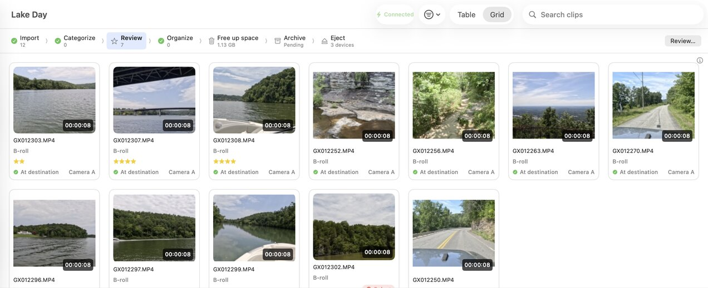

A video creator workflow has more steps than shooting and editing. Footage has to come off the card, get checked, sorted, reviewed, filed, handed to the editor, published and archived. MediaFlowSwift puts those jobs in one fixed order on a Mac. A strip across the top of each project shows what is done and what comes next.

This post walks through that order and says what each step saves you from doing by hand. The routine itself works with any tools. Where MediaFlowSwift doesn't do a job, the post says so.

## What does a video creator workflow include besides editing?

A video creator workflow includes about eight jobs around the edit. Each job is small. The trouble is that each one is easy to skip on a busy day, and a skipped job costs more later.

- Copy the card and [prove the copy matches](/blog/2026/10/checksum-verification-before-erasing-card/).
- Sort the clips by what they are, such as interview, B-roll or drone.
- Watch the clips and mark the good ones.
- File everything in folders an editor can use.
- Hand the ratings and notes to the editor, even when the editor is you.
- Write the title, description, chapters and tags.
- Clear the cards and free the space on the Mac.
- Archive the finished project, and remember which drive holds it.

MediaFlowSwift's own history shows the cost of doing these by hand. Its developer runs an RV travel channel filmed on three GoPros, two iPhones and a Nikon. The [About page](/about/) says sorting that footage into projects could take hours, sometimes days, before one project was ready to edit. The app was written to shorten that stretch.

## What are the seven steps in MediaFlowSwift's pipeline strip?

The pipeline strip is a row under the toolbar with seven steps: Import, Categorize, Review, Organize, Free up space, Archive and Eject. Each step shows how much work it still has. Each step is also a button.

| Step | What the strip counts | Its button |
|---|---|---|
| Import | Clips in the project | Import… |
| Categorize | Clips with no category | Auto-suggest |
| Review | Clips with no star rating | Review… |
| Organize | Clips not yet at the destination folder | Organize |
| Free up space | Space the leftover working copies still take on the Mac | Free Up Space… |
| Archive | Pending, or the numbered drive and the date | Archive… |
| Eject | Cards and drives still connected | Eject |

<figure class="guide-figure"><figcaption>The pipeline strip in a project called Lake Day. Seven clips still need a rating, so the strip offers Review.</figcaption></figure>

The strip follows the first step that still has work to do. A finished step shows a green check. Clicking Categorize, Review or Organize narrows the clip list to the clips that step still needs. The [manual](/manual/getting-started/#understanding-the-pipeline-strip) lists what every segment counts.

The strip replaces a checklist you would otherwise keep in your head or on paper. Nobody has to update it, because it counts from the project itself.

## How does footage get from the card into a project?

Import copies footage from SD cards, USB drives, folders, iPhones and cameras connected over USB. One Import sheet handles every source. A Camera picker records which camera shot the footage, which matters on a shoot with several cameras.

[Every copy is checked](/manual/importing-media/#every-copy-is-checked). MediaFlowSwift computes a SHA-256 checksum from the card file and writes the copy. Then it reads the whole copy back from the drive and compares the two. A copy that doesn't match is made once more. If it fails again, the import stops and names the file. Importing never deletes anything from the card.

Import can also make a second copy as it goes. The [Also copy to](/manual/importing-media/#also-copy-to) line sends each clip to a second folder or drive, and each copy is read back and checked. An iPhone import makes one copy.

By hand, the same proof means running `shasum` on the card and on the copy, then comparing the lists. [MediaFlowSwift vs Just Using Finder and a Spreadsheet](/vs/finder-and-spreadsheet/) works through the time that takes. The bigger difference is that nobody has to remember to run the check.

Import takes common video, photo and audio formats, and it counts [what it leaves out](/manual/importing-media/#what-is-left-out). Left out are camera raw stills other than DNG, AVCHD recordings, MXF, BRAW and R3D, among others. Copy those files yourself.

### Sorting happens as suggestions

After an import, MediaFlowSwift proposes a category, a camera and a scene for each new clip. A [proposal](/manual/organizing-media/#proposals-what-import-analysis-suggests) is only a suggestion. It shows in grey italics, and the clip keeps its real category until you accept. The basic pass runs on the Mac. A model can refine the proposals, but that is optional and off by default.

## How do you pick the good clips quickly?

Review is a sheet built for the keyboard. J, K and L shuttle through a clip. The number keys 1 to 5 set a star rating, F marks a Hero and X marks a Reject. The A key accepts the category and camera proposed for the clip. With auto-advance on, a rating moves you to the next clip.

The Review step on the strip counts the clips with no stars, so the number falls as you work. [How to Review Footage and Pick Your Selects on a Mac](/guides/review-and-pick-selects-on-a-mac/) covers the keys in full.

[Smart Selects](/manual/organizing-media/#smart-selects) can score every clip for sharpness, exposure and audio, then suggest a star rating. Nothing changes until you accept a suggestion. The scores are a starting point, not a verdict. Its stability score, for example, is a rough guess and doesn't measure camera shake.

## Where does the footage go for the edit?

Organize Media copies clips into a folder layout at the project's destination: Destination / Category / Camera / Filename. The destination can be a network share, an external drive, a RAID or a folder on the Mac. The categories you set while sorting become the folder names.

Organize checks each copy too. With read-back verification on, which is the default, the whole copy is read back, and its size and SHA-256 must match. With that setting off, Organize checks the size and three 1 MB samples. That is faster over a network, but it misses damage outside the samples. [How MediaFlow Verifies Copies](/manual/organizing-media/#how-mediaflow-verifies-copies) says what each check proves.

### The hand-off to your editor

Review decisions shouldn't stay behind in the footage manager. NLE Template Export writes a file Final Cut Pro can import. It carries keyword collections built from the fields you choose, plus markers, notes and ratings.

Other editors get less. The DaVinci Resolve target writes an edit decision list, which carries much less. Adobe Premiere Pro has no target yet. A CSV list works with any tool or spreadsheet. [Choosing an Export for Your Editor](/manual/reports/#choosing-an-export-for-your-editor) says exactly what each file carries.

## What helps after the edit is exported?

Prepare for YouTube works on the finished video you exported from your editor. MediaFlowSwift transcribes what is said in the video. Then a writing agent drafts five titles, a description, chapters, tags and three ideas for the words on the thumbnail. The agent works only from the transcript, your brief and your channel's voice.

A checklist beside the editor checks the draft against YouTube's rules as you type. YouTube's help pages give the rules: a [description](https://support.google.com/youtube/answer/12948449?hl=en) holds at most 5,000 characters. [Chapters](https://support.google.com/youtube/answer/9884579?hl=en) need a first timestamp at 00:00, at least three timestamps, and at least 10 seconds each. A Thumbnail tab picks a frame from the video and puts a few words over it.

In version 1.12 the public video goes up in YouTube Studio, uploaded by you. After that there are two ways to add the details:

1. **Apply to the Video I Uploaded** sets the title, description, chapters, tags, thumbnail and captions for you. Apply needs a Google Cloud project of your own, and Sending to YouTube turned on in Settings › Privacy. The [setup](/manual/publishing/#setting-up-your-google-client) is free and takes about ten minutes, once.
2. **Copy Title, Copy Description and Copy Tags** let you paste each field into the upload page. Copying needs no setup.

### Uploading from inside the app

MediaFlowSwift also has an Upload tab, which sends the finished video to your channel from the app. Uploading is part of Studio Pro, and it needs a Google Cloud project of your own. Version 1.12 calls that upload a private copy for review. The reason is an old Google rule. For years, a video uploaded through a Google Cloud project that had not passed Google's audit was locked to private. Google's [revision history](https://developers.google.com/youtube/data/revision_history) says that rule ended on November 2, 2026. Version 1.12 was written under the old rule, so it still points you to YouTube Studio for the public video.

A later version of MediaFlowSwift will upload the public video directly from the app. There is no date for it yet.

### What the writing agent needs

Two limits apply to the writing agent. Writing with the agent is part of Studio Pro. The agent also needs a model: one on the Mac, or Claude, ChatGPT or Gemini with your own API key. A paid provider receives the transcript, your brief and your channel's voice. It stays off until you turn it on in Settings › Privacy. [How to Write Your YouTube Title, Chapters and Tags](/guides/write-youtube-title-description-chapters-tags/) has the full steps.

## How do you clear cards and drives without losing anything?

Deleting in MediaFlowSwift is always a separate, deliberate step. No copy step deletes anything as a side effect. Three steps finish a project.

**Clear Card** lists every clip on the card and lets you delete only the clips it can vouch for. Each of those has an organized copy, and that copy is read back in full before the card file goes. On a [card laid out by the camera](/manual/organizing-media/#cards-laid-out-by-the-camera), such as a Sony XAVC card, Clear Card deletes nothing. It checks the card and says whether it is safe to format in the camera. [How to Clear a Memory Card Without Losing Footage](/blog/2026/10/clear-memory-card-without-losing-footage/) explains why that matters.

**Free Up Space** deals with the working copies left on the Mac. It lists every file before it touches one. It also works in two stages. Files move to a Cleanup folder first, and they are deleted only later, when you choose.

**Archive to USB** copies the finished project folder to a drive for the shelf. Every file is read back from the drive and compared by checksum. Archive drives get permanent numbers, such as USB #0001, and the strip then shows the drive number and the date. Clips organized outside the project folder aren't copied, and the Archive sheet says so first.

An archive drive is one copy, not a backup plan. The 3-2-1 rule, as [Backblaze describes it](https://www.backblaze.com/blog/the-3-2-1-backup-strategy/), asks for three copies on two different media, with one copy off-site. Count your copies before you delete a working one. MediaFlowSwift copies to drives and network shares, not to cloud storage, so the off-site copy is yours to arrange.

Eject comes last, for the cards and drives still connected.

## How do you find a clip again months later?

Search covers a clip's file name, notes, tags, category, camera and scene. Clips with transcripts can also be found by speech. Typing `said:"golden hour"` finds the clips where those words are spoken. The search reads only transcripts already on the Mac. [How to Find a Clip by What Was Said in It on a Mac](/guides/search-video-by-what-was-said/) shows the steps.

All Projects widens the search to every project. That needs the optional [shared database](/manual/shared-database/#searching-all-projects), and a database file works on either plan. For footage on the shelf, [Manage Archive Volumes](/manual/project-management/#managing-archive-volumes) lists every numbered drive and the projects on it.

## Where does this workflow stop?

MediaFlowSwift covers the jobs around the edit, not the edit. The limits are worth knowing before you try it:

- MediaFlowSwift is not an editor. It hands footage and notes to one.
- Version 1.12 does not put the public video on YouTube for you. A later version will.
- The richest hand-off file is for Final Cut Pro. Premiere Pro has no export target yet.
- Import leaves out some formats, including BRAW, R3D, MXF and most camera raw stills.
- No ASC MHL file is written, the format some clients and post houses ask for.
- Nothing is copied to cloud storage.
- The app runs on macOS 13 or later, on Apple silicon and Intel Macs. A Windows version is coming.

Crews that move many cards to many drives, or that owe a client an MHL file, are better served by an offload tool. [MediaFlowSwift vs OffShoot](/vs/offshoot/) compares the two honestly. [Best Mac Video Library App](/blog/2026/11/best-mac-video-library-app/) covers the wider field.

## How can you try the workflow without a shoot?

The demo project lets you try the review, search and YouTube steps with no footage of your own. It is a made-up shoot called Demo: Bakery Opening Day, with six clips, what was said in them, and a YouTube draft. Its clips are words only, so nothing plays. It is kept apart from your own projects.

Your own cards are the better test. The [download page](/download.html) has a 14-day trial with no card needed, and [plans](/#plans) lists what each plan includes. MediaFlowSwift has no account and collects no usage data. Your footage stays in ordinary folders on your own drives.

Whatever tools you use, the order is the part worth keeping: copy and check, sort, review, file, hand off, publish, then clear and archive.
